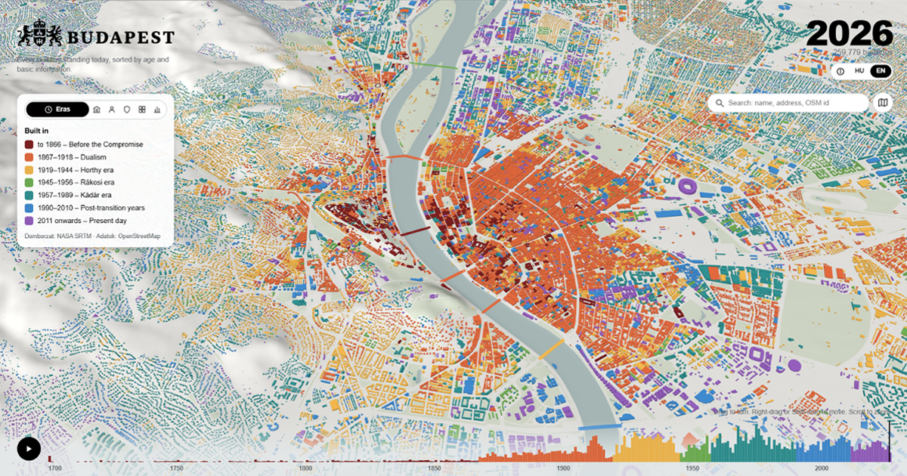

# Budapest épületei, épületenként

**Interaktív 3D térkép Budapest mintegy 260 000 épületéről, kor, építész, stílus és védettség szerint színezve.**

🇬🇧 [English](README.md) · 🌐 **Élő oldal: [budapestbuildings.com](https://budapestbuildings.com)**



## Mit tud

- Budapest minden épületét megmutatja 3D-ben, **építési korszak** szerint színezve (1867 előttől a mai napig).
- **Stílusok** és **Építészek** fül: válassz egy stílust vagy egy építészt, és a térképen kiemelődnek az épületei.
- **Védett** épületek (műemlékek és helyi védettek), **lakótelepek** és **épületmagasság** réteg.
- Egy épületre kattintva megnyílik a kártyája: név, cím, évszám, tervező, fotók és hivatkozások (Wikipédia, Wikimedia Commons, országos védettségi nyilvántartás és más források, ahol van).
- Keresés névre, címre vagy OpenStreetMap-azonosítóra. Magyar és angol felület.
- Szöveges oldalak keresőknek és megosztáshoz: [/explore/](https://budapestbuildings.com/explore/) (korszakok és építészek szerint), valamint egy oldal minden adatolt épülethez.
- Teljesen a böngészőben fut; a nyilvános oldal statikus (nincs szerver, a látogatókról csak alap, összesített statisztika készül).

### Mélylinkek

Minden nézetre lehet közvetlenül hivatkozni:

| Paraméter | Példa | Hatás |
|---|---|---|
| `lang` | `?lang=hu` | a felület nyelve (`en` vagy `hu`) |
| `tab` | `?tab=epitesz` | megnyit egy fület: `period`, `arch`, `epitesz`, `vedett`, `lakotelep`, `magassag` |
| `architect` | `?architect=Alpár Ignác` | az Építészek fület nyitja meg, a kiválasztott építésszel |
| `estate` | `?estate=<lakótelep neve>` | a Lakótelepek fület nyitja meg, és odarepül |
| `e` | `?e=w123456` | egy épülethez repül (OpenStreetMap `w` / `r` azonosító) |

## Honnan van az építési év?

Budapest épületeinek csak kis részéhez (kb. 3%) van dokumentált építési év. A többinél az évszám **becslés**, és a felület ezt jelzi. A módszert az élő oldal *Névjegy* ablaka írja le („Módszer – Becslés az épületek többségére”). A becsült éveket kérjük tájékoztató jellegűnek tekinteni, nem ténynek.

## Adatforrások

Az épületek körvonala: [OpenStreetMap](https://www.openstreetmap.org/copyright) közreműködők. Az épületmagasságok forrása: OpenStreetMap, [EUBUCCO](https://eubucco.com) (nagyrészt gépi tanulással becsült, kb. ±4 m pontossággal), kerületi szabályozási tervek, műemléki adatok és kézi javítások; ahol nincs adat, 15 m az alapérték. Védettségi adatok: országos műemléki nyilvántartás (E-Örökség). Szövegek és hivatkozások: Wikipédia, Wikidata; képek: Wikimedia Commons (minden kép saját licenccel és szerzői megjelöléssel). Domborzat: NASA SRTM.

A nyers letöltések és a harmadik féltől származó táblázatok **nem** részei ennek a tárhelynek; mindegyik forrásnak saját feltételei vannak.

## Futtatás helyben

A tárhely tartalmazza a megjelenítőt, a szerkesztő szervert és az adatfeldolgozó szkripteket. A feldolgozott adat nagy méretű és külső forrásokból épül, ezért a tárhely **önmagában nem elég a térkép nulláról való újraépítéséhez**. Előkészített adatmappával:

```
py szerkeszto_szerver.py
# majd: http://localhost:8000/terkep3d/index.html?adat=varos
```

Nyilvános kiadás (statikus fájlok, 25 MiB alatti darabokra bontva) és feltöltés a Cloudflare Workersre:

```
py kiadas_keszites.py     # létrehozza a kiadas/ mappát
kiadas_feltoltes.bat      # készítés + npx wrangler deploy kiadas
```

Ellenőrző tesztek: `py tesztek/futtat_mindent.py`

Követelmények: Python 3, Node.js (a kiadás ellenőrzéséhez és feltöltéséhez).

## Hibát találtál?

Nyiss egy [issue-t](../../issues): add meg az épületet (az oldalának linkjét vagy az OpenStreetMap-azonosítóját), mi a hiba, és ha van, a forrást. Ekkora projektben hibás vagy hiányzó adat előfordul, a javításokat szívesen fogadjuk.

## Licenc és köszönet

Kód: [MIT](LICENSE). A harmadik féltől származó részek saját licencét megtartják (`terkep3d/LICENSE-threejs.txt`).

A megjelenítő az Alex Barakov által készített [Amsterdam, building by building](https://github.com/alexbarakov/amsterdam-by-building) (MIT) projektből indult ki, köszönet az ötletért és az alapokért. Nem kereskedelmi portfólió-projekt, nem áll kapcsolatban Budapest Főváros Önkormányzatával vagy műemléki hatósággal.
