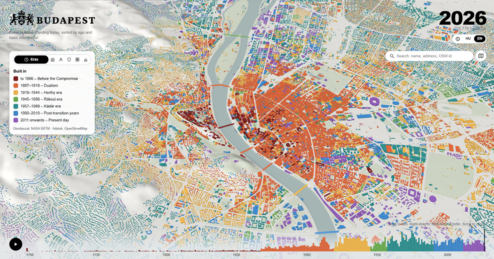

# Budapest, building by building

**An interactive 3D map of about 260,000 Budapest buildings, coloured by age, architect, style and protection status.**

🇭🇺 [Magyarul](README.hu.md) · 🌐 **Live: [budapestbuildings.com](https://budapestbuildings.com)** ([English entry page](https://budapestbuildings.com/en/))



## What it does

- Shows every building of Budapest in 3D, coloured by **construction era** (from before 1867 to the present day).
- **Styles** and **Architects** tabs: pick an architectural style or an architect and see their buildings highlighted on the map.
- **Protected** buildings (listed monuments and locally protected), **housing estates** and **building height** layers.
- Click a building for its card: name, address, year, architect, photos and links (Wikipedia, Wikimedia Commons, national heritage register and other sources where available).
- Search by name, address or OpenStreetMap id. Hungarian and English interface.
- Plain text pages for search engines and sharing: [/explore/](https://budapestbuildings.com/explore/) (by era and architect) and one page per documented building.
- Runs entirely in the browser; the public site is a static site (no server, no tracking of visitors beyond basic aggregate analytics).

### Deep links

Every view can be linked to directly:

| Parameter | Example | Effect |
|---|---|---|
| `lang` | `?lang=en` | interface language (`en` or `hu`) |
| `tab` | `?tab=epitesz` | opens a tab: `period`, `arch`, `epitesz`, `vedett`, `lakotelep`, `magassag` |
| `architect` | `?architect=Alpár Ignác` | opens the Architects tab with the architect selected |
| `estate` | `?estate=<estate name>` | opens the Housing estates tab and flies to the estate |
| `e` | `?e=w123456` | flies to a building (OpenStreetMap way `w` / relation `r` id) |

## How the construction years are obtained

Only a small part of Budapest's buildings (about 3%) has a documented construction year. For the rest the year is an **estimate**, and the interface marks estimated values as such. The method is described in the *About* window of the live site ("Method – Estimate for most buildings"). Please treat estimated years as indicative, not as facts.

## Data sources

Building footprints: [OpenStreetMap](https://www.openstreetmap.org/copyright) contributors. Building heights: OpenStreetMap, [EUBUCCO](https://eubucco.com) (largely a machine-learning estimate, roughly ±4 m), district zoning plans, heritage records and manual corrections; where no data exists, a default of 15 m is used. Heritage information: Hungarian national heritage register (E-Örökség). Texts and links: Wikipedia, Wikidata; images: Wikimedia Commons (each image carries its own licence and author credit). Terrain: NASA SRTM.

The raw data downloads and third-party tables are **not** part of this repository; each source has its own terms.

## Hungarian data field names

Identifiers in the code are English, but the **data fields** (JSON/CSV column names) and data folder names are deliberately still Hungarian, because the data files use them. The most common ones:

| Field | Meaning |
|---|---|
| `nev` | name |
| `cim` | address |
| `hazszam` | house number |
| `utca` | street |
| `kerulet / ker` | district (Budapest kerület) |
| `hrsz` | land-registry lot number (helyrajzi szám) |
| `ev` | construction year |
| `ev_szoveg` | year as free text (e.g. “1890s”) |
| `ev_tol / ev_ig` | start / end of a year range |
| `ev_forras` | source of the year (documented, estimated, …) |
| `kor / korszak` | construction era |
| `tervezo / epitesz` | architect / designer |
| `stilus` | architectural style |
| `szintek / emelet` | number of storeys / floor |
| `magassag` | building height (m) |
| `magassag_forras` | source of the height |
| `terulet` | footprint area (m²) |
| `tipus` | building type |
| `osm_tipus / osm_azonosito` | OpenStreetMap element type (`way`/`relation`) and id |
| `vedettseg / vedelem` | heritage protection status |
| `torzsszam / muemlek_torzsszam` | national heritage register number (törzsszám) |
| `forras` | source |
| `megjegyzes` | remark |
| `allapot` | status |
| `kep / foto` | image / photo |
| `kulcs` | key (unique identifier of a record) |
| `szulo_id / szulo_tipus` | parent building id / type (building parts) |
| `resz` | part of a building |
| `gyuru` | ring (polygon outline) |
| `regi / uj` | old / new value |

Folders: `forras/` = raw source data, `data/` = processed data, `data/tenyek/` = “facts” tables (one CSV per source), `terkep3d/` = the 3D viewer.

## Running it locally

The repository contains the viewer, the editor server and the data-processing scripts. The processed data is large and built from third-party sources, so the repository alone is **not enough to rebuild the map from scratch**. With a prepared data folder:

```
py editor_server.py
# then open http://localhost:8000/terkep3d/index.html?adat=varos
```

Public build (static files for hosting, split into <25 MiB files) and deployment to Cloudflare Workers:

```
py build_release.py     # creates the release/ folder
release_deploy.bat      # build + npx wrangler deploy release
```

Checks: `py tests/run_all.py`

Requirements: Python 3, Node.js (for the build check and deployment).

## Found a mistake?

Open an [issue](../../issues) with the building (a link to its page or its OpenStreetMap id), what is wrong and, if you have one, a source. Wrong or missing data is expected in a project of this size, and corrections are welcome.

## Licence and credits

Code: [MIT](LICENSE). Third-party components keep their own licences (`terkep3d/LICENSE-threejs.txt`).

The viewer is derived from [Amsterdam, building by building](https://github.com/alexbarakov/amsterdam-by-building) by Alex Barakov (MIT), which in turn follows the architecture of Sasha Bogachev's [Paris, building by building](https://paris.bogachev.fr/) — many thanks to both for the idea and the foundation. This is a non-commercial portfolio project and is not affiliated with the City of Budapest or any heritage authority.
